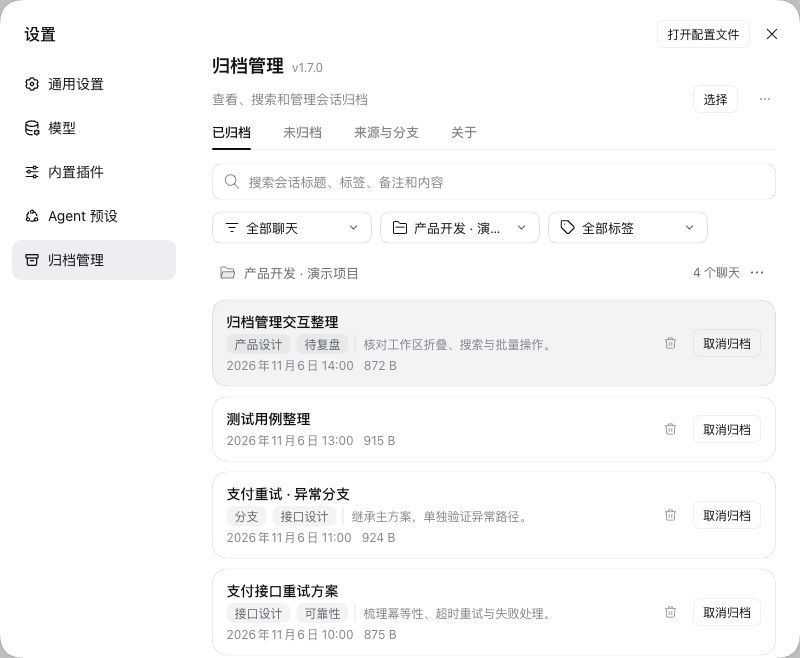
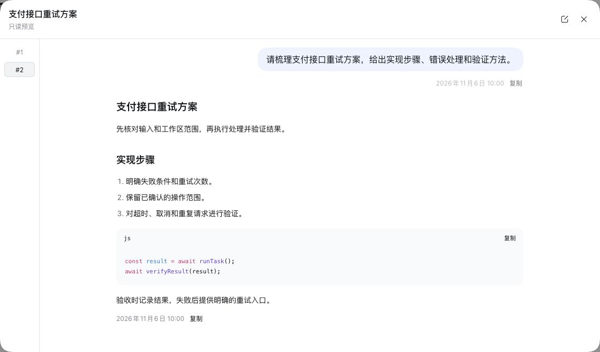
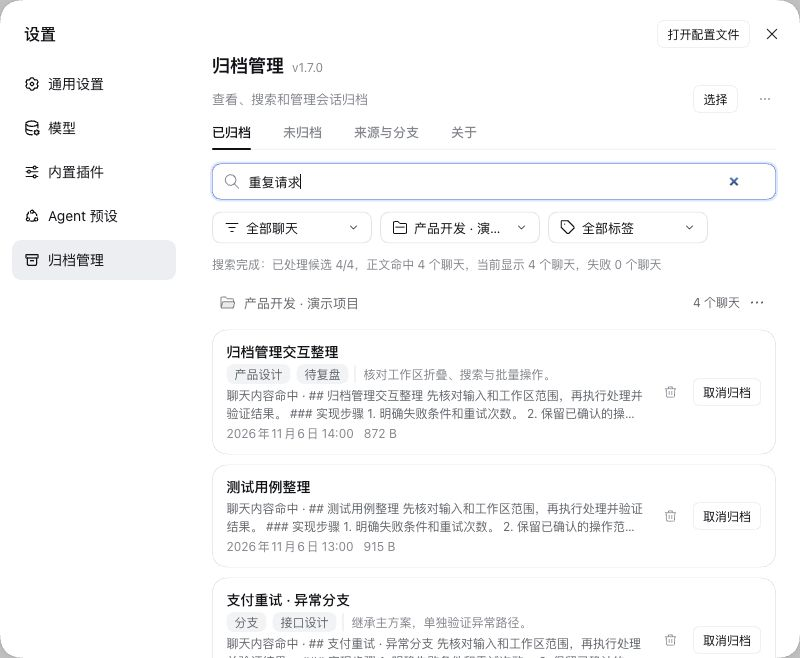
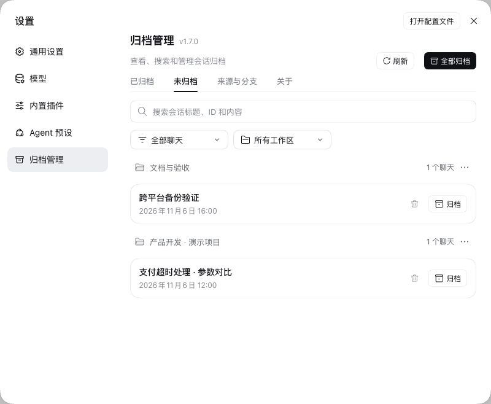
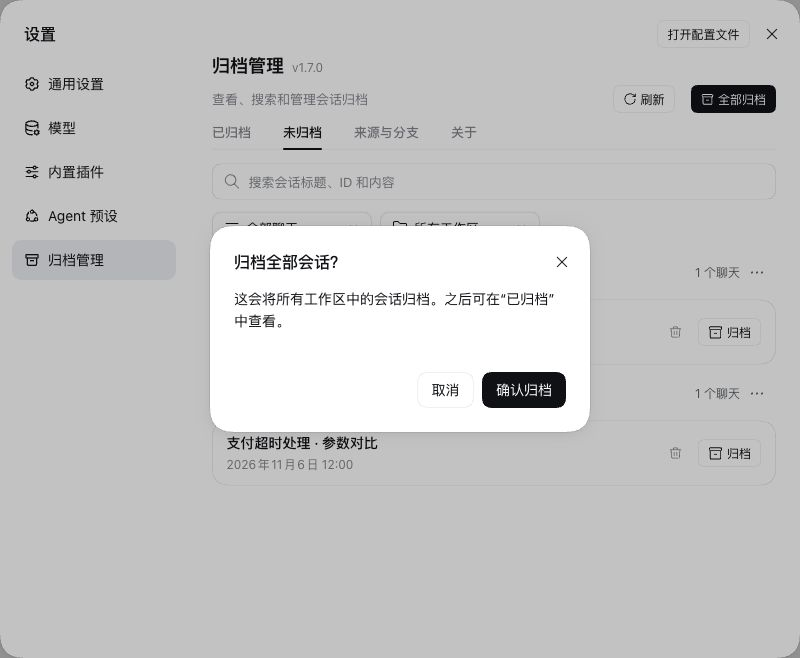
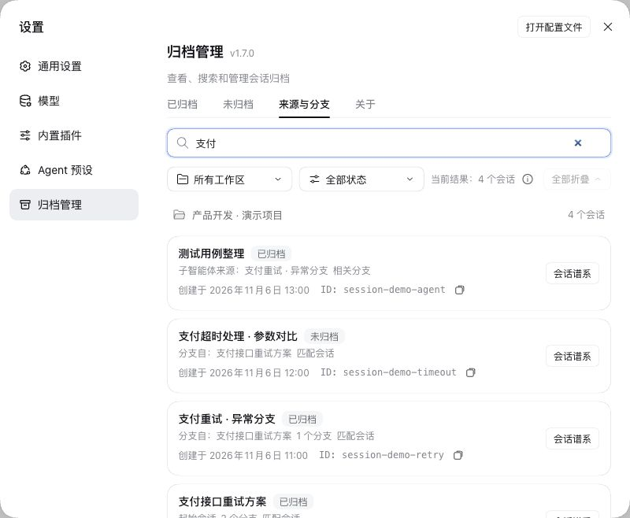
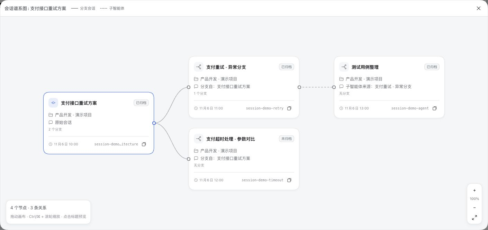
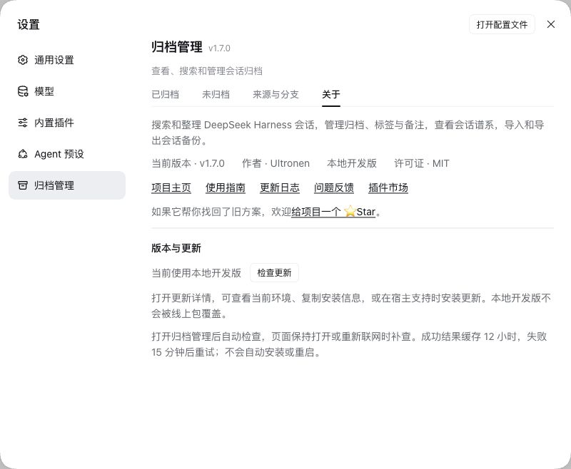

<p align="center">
  
</p>

<div align="center">

<h1>アーカイブ管理</h1>

<p><strong>DSH の過去の会話を検索し、アーカイブを管理して ZIP バックアップを保存できます。</strong></p>
<p><code>dsh-archived-chats</code></p>

<p><a href="README.md">简体中文</a> · <a href="README.en.md">English</a> · <strong>日本語</strong> · <a href="README.es.md">Español</a> · <a href="README.fr.md">Français</a> · <a href="README.de.md">Deutsch</a> · <a href="README.ru.md">Русский</a> · <a href="README.pt-BR.md">Português (Brasil)</a></p>

<p><a href="CHANGELOG.md">Changelog</a> · <a href="LICENSE">MIT License</a></p>

<p>
  <a href="https://www.npmjs.com/package/dsh-archived-chats"></a>
  <a href="#%E3%83%90%E3%83%BC%E3%82%B8%E3%83%A7%E3%83%B3%E3%81%AE%E5%A4%89%E6%9B%B4%E3%81%A8%E4%BA%92%E6%8F%9B%E6%80%A7"></a>
  <a href="https://www.npmjs.com/package/dsh-archived-chats"></a>
  <a href="LICENSE"></a>
  <a href="https://dsh-insights.com/p/Ultroncn/dsh-archived-chats/"></a>
</p>

<p><a href="https://awesome-dsh-plugin.com/p/Ultroncn/dsh-archived-chats/">Plugin market</a> · <a href="https://www.npmjs.com/package/dsh-archived-chats">npm</a> · <a href="https://github.com/Ultroncn/dsh-archived-chats/releases">Releases</a> · <a href="https://github.com/Ultroncn/dsh-archived-chats/discussions">Discussions</a> · <a href="https://github.com/Ultroncn/dsh-archived-chats/security/advisories/new">Private security report</a></p>

</div>

> コミュニティが保守する DeepSeek Harness プラグインであり、DeepSeek AI の公式製品ではありません。

Archive Management は、DeepSeek Harness にチャットの検索、整理、バックアップ機能を追加します。過去のチャットから解決策を探して前後のやり取りを確認したり、ワークスペース単位でアーカイブしたり、削除前に ZIP で保存したりできます。

- **チャットの全文検索** — アーカイブ済み・未アーカイブの各ページで、タイトル、メッセージ本文、ツールの実行結果を検索できます。アーカイブ済みのチャットはタグとメモも検索できます。一致したターンは前後の文脈付きで表示され、該当箇所に直接移動できます。
- **チャットの整理** — ワークスペース別のグループと未分類のチャットを管理できます。一括操作、タグ、メモにも対応しています。
- **持ち運べるバックアップ** — JSON と Markdown を含む ZIP をエクスポートおよびインポートできます。インポートは書き込み前にプレビューでき、既存の ID はスキップされるため上書きされません。
- **チャットの系譜** — 読み取り専用の **Origins & Branches** では、ワークスペースやアーカイブ状態を問わず、チャットの起点、分岐、サブエージェントとの関係を確認できます。

> この文書はバージョン 2.0.4 を対象としています。従来の復旧機能は廃止されました。完了していない完全削除タスクは、ユーザーの操作で再試行できます。

## インストールと起動

DSH のプラグインマーケットで `dsh-archived-chats` を検索し、作者が **Ultroncn** であることを確認してインストールします。ホストの案内に従って再起動し、**Settings → Archive Management**（中国語 UI では **设置 → 归档管理**）を開きます。

CLI からもインストールできます。`web` はプロファイル名の例です。実行中の DSH プロファイル名に置き換え、更新時とアンインストール時にも同じ名前を指定してください。

```sh
dsh plugin --profile web add dsh-archived-chats@latest
```

`ERR_PNPM_ADDING_TO_ROOT` が表示された場合は、`add` の直後に `-w` を追加してください。更新には次のコマンドを使います。

```sh
dsh plugin --profile web update dsh-archived-chats
```

## チャットの検索とバックアップ

1. **Unarchived** を開き、タイトルをクリックして内容を確認し、残したいチャットをアーカイブします。作成直後の空のチャットは対象外です。実行中のチャットには **Stop and archive** での確認が必要です。
2. **Archived** で検索し、タイトルまたは一致した抜粋からプレビューを開きます。プレビューでタグとメモを編集できます。
3. **Select** を選び、対象のチャットにチェックを入れて **Export selected** を実行します。画面幅が狭い場合、この操作は三点メニューにあります。ZIP が保存されたことをブラウザーのダウンロード一覧で確認してください。
4. チャットを再開するには **Unarchive** を選びます。削除は取り消せないため、実行前にバックアップが必要か確認してください。

## 各ページでできること

| ページ | 主な機能 |
| --- | --- |
| Archived（アーカイブ済み） | 検索、絞り込み、プレビュー、タグとメモ、インポートとエクスポート、アーカイブ解除、確認付きの完全削除 |
| Unarchived（未アーカイブ） | ワークスペース別と未分類のチャット一覧、対象範囲を指定した検索、プレビュー、アーカイブ、確認付きの完全削除 |
| Origins & Branches（起点と分岐） | 全ワークスペース・全アーカイブ状態の起点、分岐、サブエージェントの読み取り専用ビュー |
| About（プラグイン情報） | 自動更新チェック、ホストとローカルチェックアウトの検出、インストール情報のコピー、ホストが対応する更新操作 |

本文検索は 2 文字から利用でき、選択範囲を分割して検索しながら進捗、一致箇所、失敗を表示します。検索の停止や再試行もできます。**Archived** はアーカイブ済み、**Unarchived** は未アーカイブのチャットを対象とし、どちらからも一致箇所のプレビューを開けます。一括アーカイブでは、一覧で非表示になるセッションも対象から除外されます。検索範囲や長いログの制限は、[ユーザーガイド](docs/USER_GUIDE.md)を参照してください。

## アーカイブと完全削除

アーカイブとアーカイブ解除には、DSH ホストの公式操作を使います。個別削除、選択したチャットの削除、ワークスペース内の **Delete all**、全体の **Delete all** はいずれも確認が必要です。全体の **Delete all** は、すべてのワークスペースのアーカイブ済みチャットを対象にします。検索や絞り込みを使っていても、ワークスペース単位または全体の一括操作の対象範囲は変わりません。

完全削除の対象は、選択したチャットと配下のサブエージェントが専用で使うセッションディレクトリおよび対応するレコードです。プロジェクトディレクトリとそのファイル、セッションディレクトリ外の共有添付ファイル、独立したバックアップは保持されます。

完全削除に失敗するとエラーが表示され、未完了の処理状態が保持されます。**Retry** を選ぶと、確認済みの範囲で処理を再開できます。以前の復旧操作や保護スナップショット機能は廃止されました。確定済みの削除タスクは引き継がれます。詳細は[完全削除と再試行](docs/USER_GUIDE.md#permanent-deletion-and-retries)を参照してください。

作業ディレクトリのないチャットは、ホストのメイン一覧からアクセスできるようになるまで **Archived** に残ります。

## ZIP バックアップと保存範囲

チャットのバックアップ ZIP には、JSON、Markdown、タグ、メモ、添付ファイルへの参照が含まれます。添付ファイル本体を保存したり、配下のサブエージェントのチャットを自動で同梱したりする機能はありません。復元時は **Import backup** で内容を確認できます。既存の ID はスキップされます。

エクスポート時は、インポートと同じ形式要件および容量などの制限を満たしていることを確認してからダウンロードを開始します。ファイルが保存されたかどうかは、ブラウザーのダウンロード一覧で確認してください。

## バージョンの変更と互換性

旧バージョンに戻すと、当時のクリーンアップルールも再び適用される場合があります。ダウングレードの前にデータ全体をバックアップし、未完了のタスクとデータ形式の互換性を確認してください。

宣言されている DSH の対応範囲は `>=0.1.0-rc.7 || 0.2.2-rc.1 || 0.2.2-rc.2 || 0.2.2-rc.3` です。各機能の利用可否はホストの対応状況によります。ネイティブ統合テストは公式の `0.1.7-rc.2`、`0.2.1-rc.2`、`0.2.1-rc.5`、`0.2.2-rc.1`、`0.2.2-rc.3` のバックエンドを対象とし、CI は macOS、Windows、Linux でホストのテストを実行します。

アーカイブ、アーカイブ解除、チャット一覧の取得にはホストの公式機能を使います。完全削除はホストのセッションライフサイクルと保存先を連携させて処理します。詳細は[互換性と制限](docs/USER_GUIDE.md#compatibility-and-limits)を参照してください。

## スクリーンショット

<details>
<summary>スクリーンショットを表示</summary>

画像には隔離した公式ホスト上のデモ用チャットを使用しています。

1. ワークスペース別のアーカイブ済みチャット

   
2. 読み取り専用のチャットプレビュー

   
3. 本文検索と一致箇所の抜粋

   
4. 未アーカイブのチャット

   
5. 一括アーカイブの確認

   
6. 起点と分岐の一覧

   
7. チャットの系譜グラフ

   
8. プラグイン情報と更新

   

</details>

## アンインストール

```sh
dsh plugin --profile web remove dsh-archived-chats
```

パッケージをアンインストールしても、プラグインのデータとチャットは保持されます。詳細は[ローカルデータとアンインストール](docs/USER_GUIDE.md#local-data-and-uninstall)を参照してください。

## ドキュメントとフィードバック

[ユーザーガイド](docs/USER_GUIDE.md) · [アーキテクチャ](docs/ARCHITECTURE.en.md) · [変更履歴](CHANGELOG.md) · [サポート](SUPPORT.md) · [貢献ガイド](CONTRIBUTING.md) · [MIT ライセンス](LICENSE)

質問と提案は [GitHub Discussions](https://github.com/Ultroncn/dsh-archived-chats/discussions) に投稿してください。不具合報告にはプラグインと DSH のバージョン、最小限の再現手順、機密情報を除いたエラーを添えてください。セキュリティ上の問題は[非公開で報告](SECURITY.md)してください。

開発時のコマンドは[英語版 README の開発と検証](README.en.md#development-and-validation)に掲載しています。ネイティブ統合テストは隔離された一時データを使います。各フィクスチャで 9 件すべてのテストをスキップせずに実行してください。
