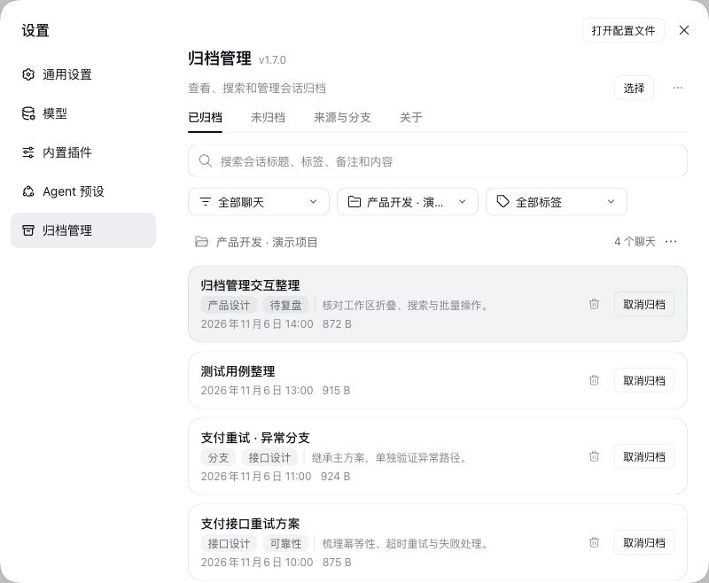
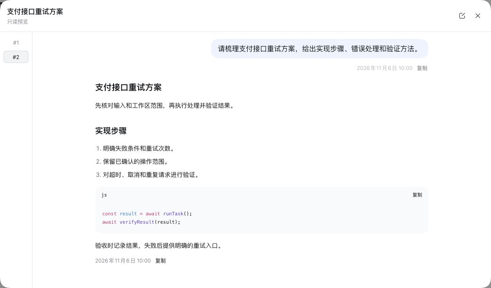
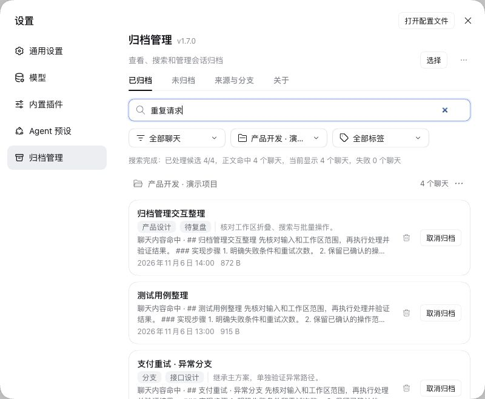
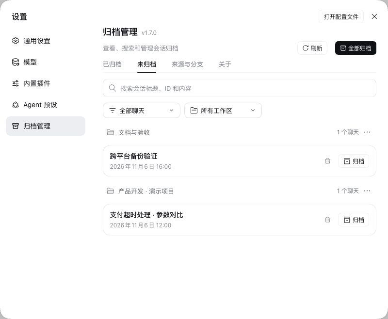
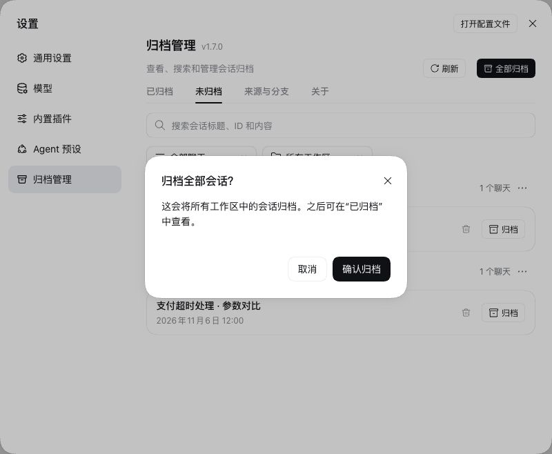
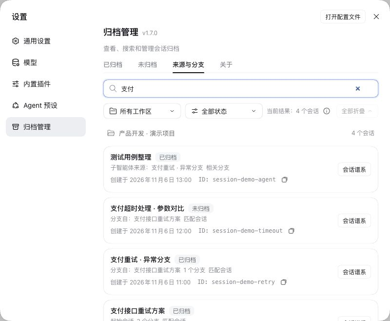
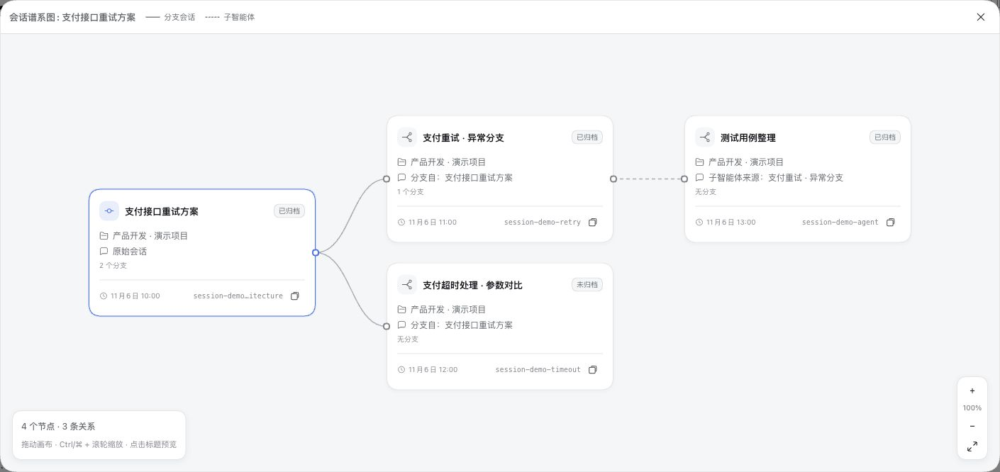
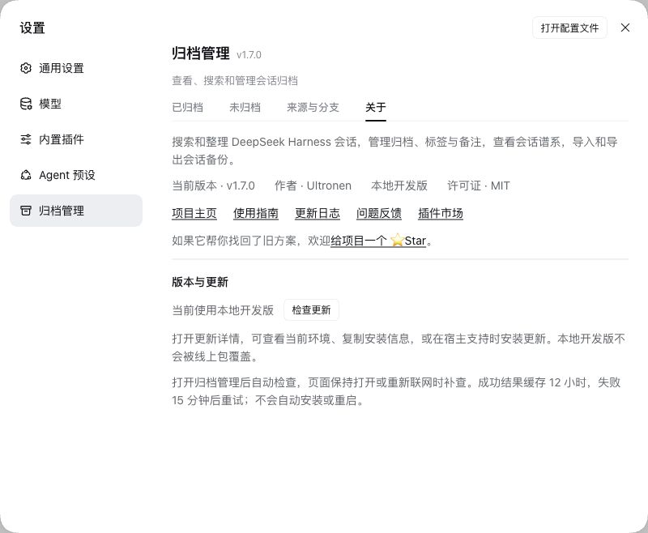

<p align="center">
  
</p>

<div align="center">

<h1>归档管理</h1>

<p><strong>找回 DSH 历史对话，搜索、管理归档并保存 ZIP 备份。</strong></p>
<p><code>dsh-archived-chats</code></p>

<p><strong>简体中文</strong> · <a href="README.en.md">English</a> · <a href="README.ja.md">日本語</a> · <a href="README.es.md">Español</a> · <a href="README.fr.md">Français</a> · <a href="README.de.md">Deutsch</a> · <a href="README.ru.md">Русский</a> · <a href="README.pt-BR.md">Português (Brasil)</a></p>

<p><a href="CHANGELOG.md">更新日志</a> · <a href="LICENSE">MIT 许可证</a></p>

<p>
  <a href="https://www.npmjs.com/package/dsh-archived-chats"></a>
  <a href="#%E5%85%BC%E5%AE%B9%E6%80%A7">=0.1.0-rc.7" src="https://img.shields.io/badge/DSH-%3E%3D0.1.0--rc.7-2563eb?style=flat"></a>
  <a href="https://www.npmjs.com/package/dsh-archived-chats"></a>
  <a href="LICENSE"></a>
  <a href="https://dsh-insights.com/p/Ultroncn/dsh-archived-chats/"></a>
</p>

<p><a href="https://awesome-dsh-plugin.com/p/Ultroncn/dsh-archived-chats/">插件市场</a> · <a href="https://www.npmjs.com/package/dsh-archived-chats">npm</a> · <a href="https://github.com/Ultroncn/dsh-archived-chats/releases">版本发布</a> · <a href="https://github.com/Ultroncn/dsh-archived-chats/discussions">问题交流</a> · <a href="https://github.com/Ultroncn/dsh-archived-chats/security/advisories/new">私密报告漏洞</a></p>

</div>

> 归档管理是社区维护的 DeepSeek Harness 插件，并非 DeepSeek AI 官方产品。

归档管理为 DeepSeek Harness 补充会话查找、整理和备份能力。搜索过去的解决方案，直接预览内容，按工作区归档，或在删除前保存一份 ZIP 备份。

- **深度搜索：** 在已归档或未归档各自范围内搜索标题、消息正文和工具结果，已归档还支持标签和备注；结果直接展示命中轮次及其上下文，支持跳转定位。
- **整理会话：** 管理已归档和未归档聊天，支持工作区分组、未分组、批量操作及标签备注。
- **可迁移备份：** 导出和导入 JSON + Markdown ZIP；导入前预览，跳过已有 ID，不覆盖现有数据。
- **会话溯源：** 只读的「来源与分支」视图查看所有工作区中已归档、未归档会话的来源、分叉和子代理关系。

> 本文描述 2.0.7，旧恢复功能已移除，永久删除支持任务重试。

<a name="install-and-open"></a>

## 安装与打开

在 DSH 插件市场搜索 `dsh-archived-chats`，核对作者 **Ultroncn** 后安装。按宿主提示重启，打开 **设置 → 归档管理**（英文为 Archive Management）。

也可使用命令行。`web` 是示例 profile，请替换为实际运行 DSH 的 profile，更新和卸载也使用同一个：

```sh
dsh plugin --profile web add dsh-archived-chats@latest
```

若提示 `ERR_PNPM_ADDING_TO_ROOT`，在 `add` 后加 `-w`。更新命令：

```sh
dsh plugin --profile web update dsh-archived-chats
```

<a name="first-task"></a>

## 第一次使用

1. 打开 **未归档**，点击聊天标题预览，选择需要保留的聊天并归档。空白新聊天不列入可归档范围；正在执行的聊天需要先确认「停止并归档」。
2. 在 **已归档** 搜索关键词，点击标题或命中片段查看内容；在预览中编辑标签和备注。
3. 点击 **选择**，勾选聊天后 **导出选中**；窄屏下该操作位于三点菜单。到浏览器下载中确认 ZIP 已保存。
4. 需要继续聊天时 **取消归档**。删除会话前先确认备份是否需要保留；删除为不可撤销的永久删除。

删除覆盖所选会话及其子智能体后代的专属存储目录和对应记录。项目文件、会话目录外的共享附件及独立备份保留。详见[删除范围与失败重试](docs/USER_GUIDE.zh-CN.md#永久删除与失败重试)。

<a name="pages-and-capabilities"></a>

## 页面与能力

| 页面 | 用途 |
| --- | --- |
| 已归档 | 搜索、筛选、预览、标签备注、导入导出、取消归档和确认永久删除。 |
| 未归档 | 工作区及未分组聊天，范围内搜索、预览、归档和确认永久删除。 |
| 来源与分支 | 查看所有工作区中会话的来源、分叉和子代理关系，包含已归档及未归档；只读，不改变会话。 |
| 关于 | 自动检查更新、运行环境与本地开发版识别、复制安装信息、宿主支持时一键更新。 |

正文搜索从两个字符开始，分批扫描当前筛选范围，展示进度、命中和失败数量；支持停止和重试。完整范围、长日志限制及操作说明见[用户指南](docs/USER_GUIDE.zh-CN.md)。

已归档只搜索已归档，未归档只搜索未归档。两个列表均支持正文搜索和命中上下文定位；批量归档与列表共用隐藏会话排除规则。

<a name="archive-and-delete"></a>

## 归档与删除

**归档用于整理，删除用于永久移除。** 归档和取消归档使用 Host 的官方操作。行内垃圾桶、选中删除、工作区全部删除和全局全部删除均需确认；工作区删除不会删除项目目录。搜索和筛选不会缩小工作区或全局操作范围。


<a name="backups-and-data-boundaries"></a>

## 备份与数据边界

| 格式 | 内容 | 使用方式 |
| --- | --- | --- |
| 会话备份 ZIP | JSON、Markdown、标签备注及附件引用；不包含附件文件，不自动打包后代会话。 | 通过「导入备份」预览后导入；已有 ID 跳过。 |

导出成功前会按导入使用的同一格式和预算完成验证。浏览器提示开始下载不代表文件已保存，需自行核对下载结果。

<a name="upgrading-from-older-releases"></a>

## 从旧版升级

重新安装旧版本可能重新启用其原有清理规则；降级前应保留完整数据备份，并确认待删除任务和数据格式兼容。

<a name="compatibility"></a>

## 兼容性

声明范围为 DSH `>=0.1.0-rc.7`，具体能力仍取决于 Host。原生集成测试覆盖官方 `0.1.7-rc.2`、`0.2.1-rc.2`、`0.2.1-rc.5`、`0.2.2-rc.1` 与 `0.2.2-rc.3` 后端；CI 在 macOS、Windows 和 Linux 上运行 Host 测试矩阵。

归档、取消归档、列表读取以官方能力为基础。永久删除由插件协调会话生命周期和存储位置完成，并非调用一个官方统一删除接口。详见[兼容性与限制](docs/USER_GUIDE.zh-CN.md#兼容性与限制)。

<a name="screenshots"></a>

## 界面截图

<details>
<summary>查看界面截图</summary>

截图使用隔离的官方 Host 和演示会话。

### 1. 按工作区整理已归档会话



### 2. 只读会话预览



### 3. 正文搜索与命中片段



### 4. 未归档会话



### 5. 批量归档确认



### 6. 来源与分支列表



### 7. 会话谱系图



### 8. 关于与版本更新



</details>

<a name="documentation-and-feedback"></a>

## 文档与反馈

[用户指南](docs/USER_GUIDE.zh-CN.md) · [架构说明](docs/ARCHITECTURE.md) · [更新日志](CHANGELOG.md) · [支持](SUPPORT.md) · [贡献指南](CONTRIBUTING.md)

使用问题和建议欢迎前往 [Discussions](https://github.com/Ultroncn/dsh-archived-chats/discussions)；缺陷请附插件与 DSH 版本、最小复现步骤和脱敏错误。安全问题请[私密报告](SECURITY.md)。若帮助你找回了旧方案，欢迎[给项目一个 Star](https://github.com/Ultroncn/dsh-archived-chats)。

<a name="development-and-validation"></a>

## 开发与验证

[](https://github.com/Ultroncn/dsh-archived-chats/actions/workflows/ci.yml) [](https://github.com/Ultroncn/dsh-archived-chats/actions/workflows/ci.yml)

```sh
npm test
npm ci --prefix test/fixtures/native-host --ignore-scripts --include=optional
node scripts/run-native-integration.mjs
npm ci --prefix test/fixtures/native-host-0.2.1-rc.2 --ignore-scripts --include=optional
node scripts/run-native-integration.mjs --fixture-root test/fixtures/native-host-0.2.1-rc.2
npm ci --prefix test/fixtures/native-host-0.2.1-rc.5 --ignore-scripts --include=optional
node scripts/run-native-integration.mjs --fixture-root test/fixtures/native-host-0.2.1-rc.5
npm install --prefix test/fixtures/native-host-0.2.2-rc.1 --ignore-scripts --include=optional --package-lock=true
node scripts/run-native-integration.mjs --fixture-root test/fixtures/native-host-0.2.2-rc.1
npm ci --prefix test/fixtures/native-host-0.2.2-rc.3 --ignore-scripts --include=optional
node scripts/run-native-integration.mjs --fixture-root test/fixtures/native-host-0.2.2-rc.3
npm pack --dry-run --json
```

原生测试使用隔离临时数据，每套 9 项均要求执行且不能跳过。提交贡献前请完整阅读[贡献指南](CONTRIBUTING.md)。

<a name="uninstall"></a>

## 卸载

```sh
dsh plugin --profile web remove dsh-archived-chats
```

卸载插件包保留插件数据，不执行永久删除。详见[本地数据与卸载](docs/USER_GUIDE.zh-CN.md#本地数据与卸载)。

<a name="deletion-failures"></a>

## 删除失败处理

永久删除失败时显示错误提示，并在后台保留未完成状态。当前版本移除旧恢复与保护快照操作，仅承接已确认的待删除任务。


没有工作目录的聊天会留在已归档，取消归档前需确认官方主列表能读取该会话。

[MIT License](LICENSE)
