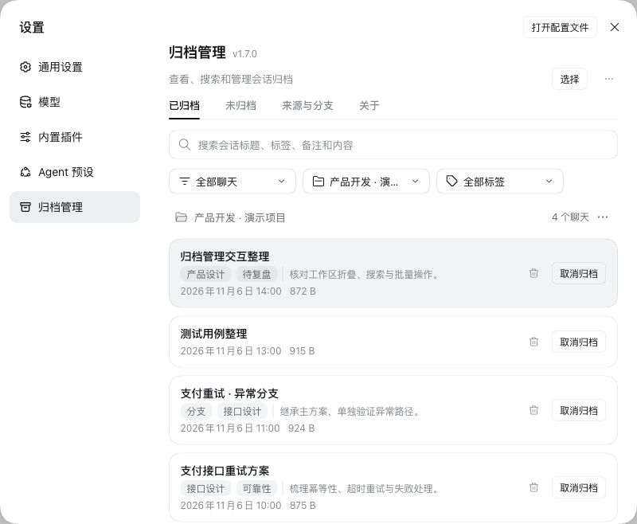
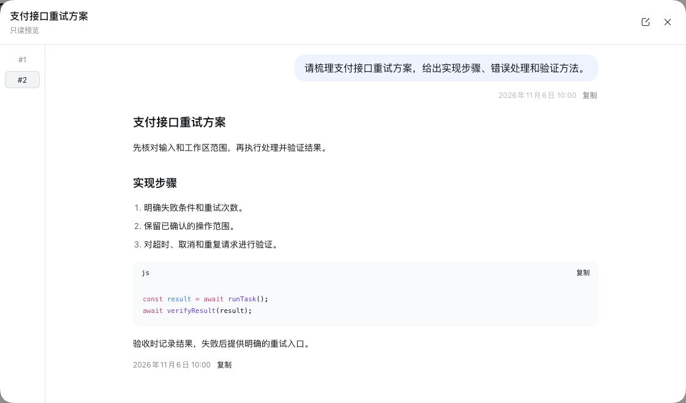
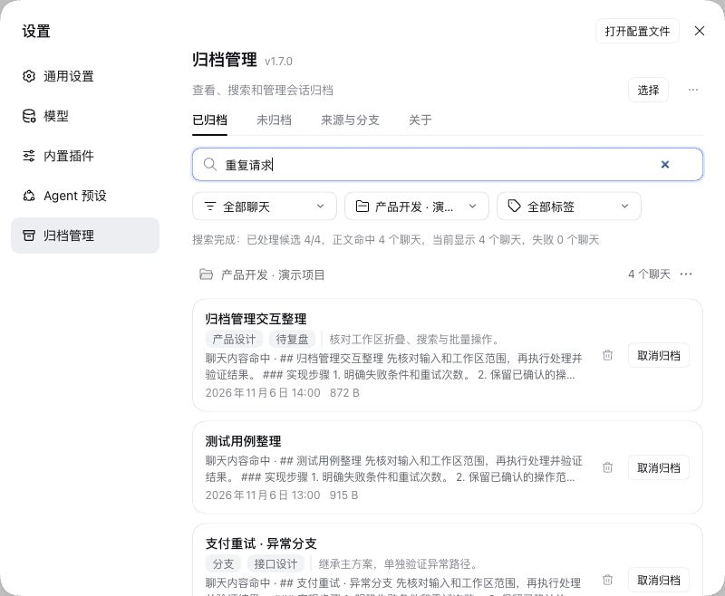
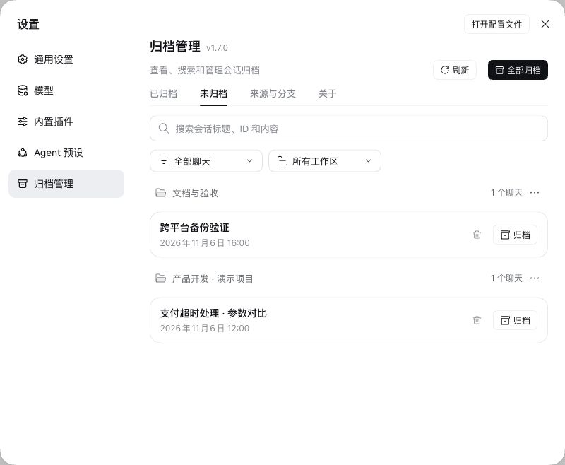
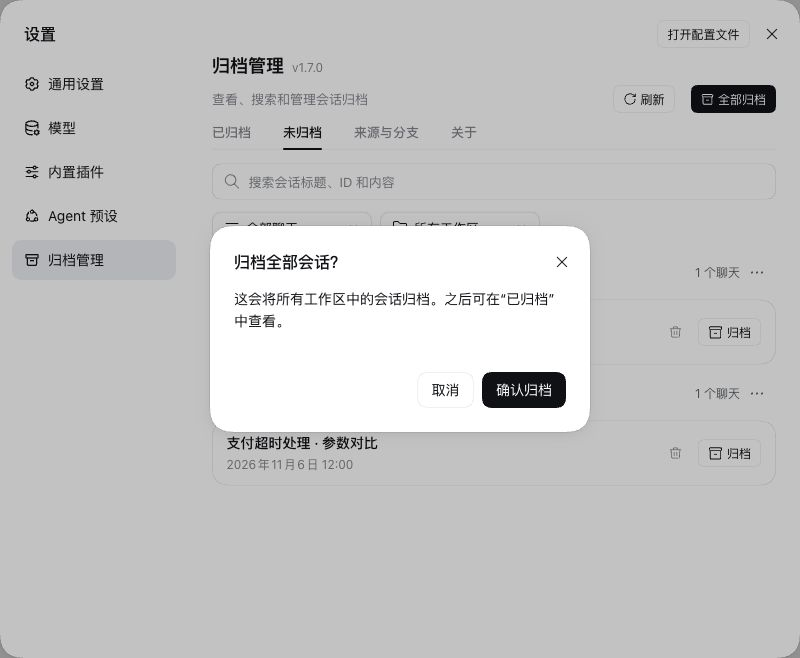
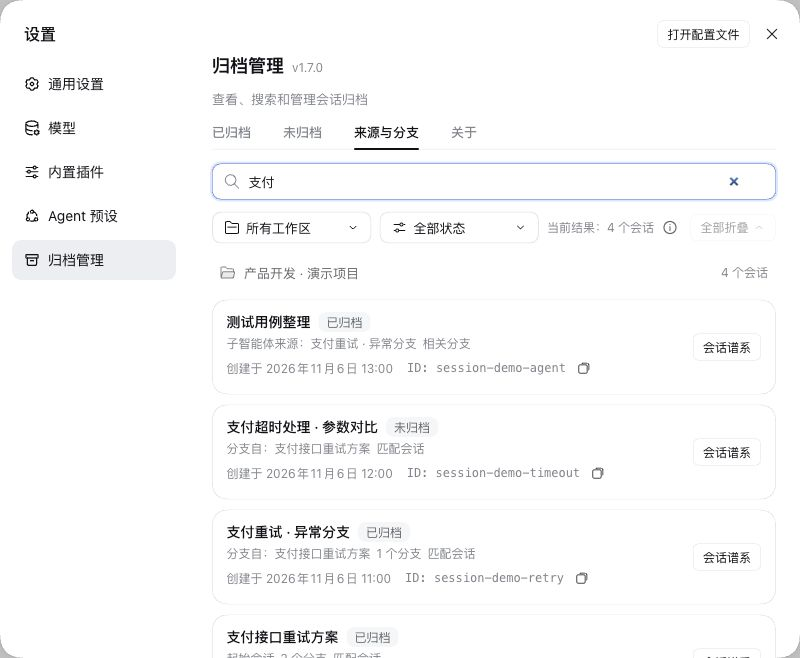
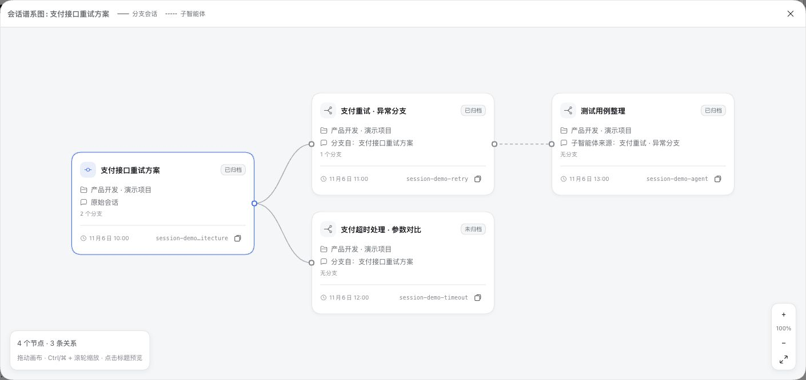
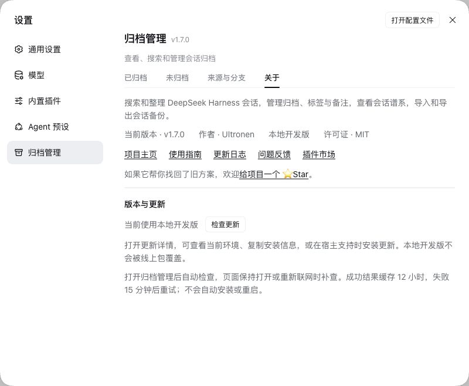

[](https://dsh-insights.com/p/Ultronen/dsh-archived-chats/)

<p align="center">
  
</p>

<div align="center">

<h1>Archive Management</h1>

<p><strong>Find past DSH chats, manage archives, and keep ZIP backups.</strong></p>
<p><code>dsh-archived-chats</code></p>

<p>
  <a href="https://www.npmjs.com/package/dsh-archived-chats"></a>
  <a href="https://www.npmjs.com/package/dsh-archived-chats"></a>
  <a href="https://github.com/Ultroncn/dsh-archived-chats/actions/workflows/ci.yml"></a>
  <a href="https://github.com/Ultroncn/dsh-archived-chats/actions/workflows/ci.yml"></a>
</p>
<p>
  <a href="https://github.com/Ultroncn/dsh-archived-chats/blob/main/LICENSE"></a>
  <a href="https://awesome-dsh-plugin.com/p/Ultroncn/dsh-archived-chats/"></a>
  <a href="https://github.com/Ultroncn/dsh-archived-chats/stargazers"></a>
</p>

<p>English · <a href="README.zh-CN.md">简体中文</a></p>
<p><a href="https://awesome-dsh-plugin.com/p/Ultroncn/dsh-archived-chats/">Plugin market</a> · <a href="https://www.npmjs.com/package/dsh-archived-chats">npm</a> · <a href="https://github.com/Ultroncn/dsh-archived-chats/releases">Releases</a> · <a href="https://github.com/Ultroncn/dsh-archived-chats/discussions">Discussions</a> · <a href="https://github.com/Ultroncn/dsh-archived-chats/security/advisories/new">Private security report</a></p>

</div>

Archive Management adds conversation search, organization and backups to DeepSeek Harness. Find a past solution, preview its context, archive by workspace, or save a ZIP before deleting a chat.

- **Deep search:** search titles, message bodies and tool results within Archived or Unarchived, plus tags and notes in Archived; results show the matching turn in context with a direct link to jump there.
- **Organize chats:** manage Archived and Unarchived, including workspace groups, ungrouped chats, bulk actions, tags and notes.
- **Portable backups:** export and import JSON + Markdown ZIPs; imports preview before writing and skip existing IDs to avoid overwrites.
- **Conversation lineage:** read-only Origins & Branches view traces sources, forks and subagent relationships across all workspaces, including archived and unarchived chats.

> This document describes version 2.0.0. Previous recovery features are removed, with explicit retries for permanent-deletion tasks.

## Install and open

Find `dsh-archived-chats` in the DSH plugin market, verify author **Ultronen**, and install. Follow the host's restart prompt, then open **Settings → Archive Management** (Chinese: **设置 → 归档管理**).

Alternatively, use the CLI. `web` is an example profile; replace it with your running DSH profile and use the same profile for updates and removal:

```sh
dsh plugin --profile web add dsh-archived-chats@latest
```

If installation reports `ERR_PNPM_ADDING_TO_ROOT`, add `-w` after `add`. To update:

```sh
dsh plugin --profile web update dsh-archived-chats
```

## First task

1. Open **Unarchived**, click a chat title to preview it, then archive the chat you want to keep. Blank new chats are excluded; running chats require explicit **Stop and archive** confirmation.
2. Search **Archived**, open a title or matching snippet, and edit tags and notes from the preview.
3. Choose **Select**, check chats, and choose **Export selected**; narrow layouts place this action in the three-dot menu. Verify the ZIP in browser downloads.
4. **Unarchive** to continue chatting. Before deleting, decide whether to keep a backup: deletion is permanent and cannot be undone.

Deletion covers the exclusive session directories and corresponding records of selected chats and their subagent descendants. Project files, shared attachments outside session directories, and independent backups are retained. See [deletion scope and retries](docs/USER_GUIDE.md#permanent-deletion-and-retries).

## Pages and capabilities

| Page | Purpose |
| --- | --- |
| Archived | Search, filter, preview, tags and notes, import/export, unarchive and confirmed permanent deletion. |
| Unarchived | Workspace and ungrouped chats, scoped search, preview, archive and confirmed permanent deletion. |
| Origins & Branches | Read-only sources, forks and subagents across all workspaces and archive states. |
| About | Automatic update checks, host and local-checkout detection, copyable installation details, host-supported updates. |

Content search starts at two characters and scans the selected scope in batches, showing progress, matches and failures; it supports Stop and Retry. See the [user guide](docs/USER_GUIDE.md) for scope, long-log limits and detailed operations.

Archived searches archived chats; Unarchived searches unarchived chats. Both support body search and anchored previews. Bulk archive shares the list’s hidden-session exclusions.

## Archive and delete

**Archive organizes; Delete permanently removes.** Archive and unarchive use official Host operations. Row deletion, selected deletion, workspace Delete all and global Delete all require confirmation. Workspace deletion never deletes project directories. Search and filters do not narrow workspace or global bulk actions.


## Backups and data boundaries

| Format | Contents | Use |
| --- | --- | --- |
| Conversation backup ZIP | JSON, Markdown, tags, notes and attachment references; no attachment bytes or automatic descendant bundling. | Preview with Import backup, then restore; existing IDs are skipped. |

Successful exports are validated against the same format and budgets as import before the download starts. A download-started notice does not confirm the file was saved; check browser downloads.

## Upgrading from older releases

Installing an older release can restore its earlier cleanup rules. Before downgrading, keep a full data backup and check pending tasks and format compatibility.

## Compatibility

The declared range is DSH `>=0.1.0-rc.7 || 0.2.2-rc.1`; features still depend on Host capabilities. Native integration tests cover official `0.1.7-rc.2`, `0.2.1-rc.2`, `0.2.1-rc.5` and `0.2.2-rc.1` backends; CI runs the Host matrix on macOS, Windows and Linux.

Archive, unarchive and inventory use official capabilities. Permanent deletion coordinates Host session lifecycle and storage locations rather than calling one unified public deletion API. See [compatibility and limits](docs/USER_GUIDE.md#compatibility-and-limits).

## Screenshots

<details>
<summary>View screenshots</summary>

Screenshots use demonstration conversations in an isolated official Host.

### 1. Archived chats by workspace



### 2. Read-only conversation preview



### 3. Content search and matching snippets



### 4. Unarchived conversations



### 5. Bulk archive confirmation



### 6. Origins & branches list



### 7. Conversation lineage graph



### 8. About and updates



</details>

## Documentation and feedback

[User guide](docs/USER_GUIDE.md) · [Architecture](docs/ARCHITECTURE.en.md) · [Changelog](CHANGELOG.md) · [Support](SUPPORT.md) · [Contributing](CONTRIBUTING.md)

Use [Discussions](https://github.com/Ultroncn/dsh-archived-chats/discussions) for questions and suggestions. Bug reports should include plugin and DSH versions, minimal reproduction steps and redacted errors. Report security issues [privately](SECURITY.md). If this helped you find past work, consider [giving the project a Star](https://github.com/Ultroncn/dsh-archived-chats).

## Development and validation

```sh
npm test
npm ci --prefix test/fixtures/native-host --ignore-scripts --include=optional
node scripts/run-native-integration.mjs
npm ci --prefix test/fixtures/native-host-0.2.1 --ignore-scripts --include=optional
node scripts/run-native-integration.mjs --fixture-root test/fixtures/native-host-0.2.1
npm ci --prefix test/fixtures/native-host-0.2.1-rc.5 --ignore-scripts --include=optional
node scripts/run-native-integration.mjs --fixture-root test/fixtures/native-host-0.2.1-rc.5
npm install --prefix test/fixtures/native-host-0.2.2-rc.1 --ignore-scripts --include=optional --package-lock=true
node scripts/run-native-integration.mjs --fixture-root test/fixtures/native-host-0.2.2-rc.1
npm pack --dry-run --json
```

Native checks use isolated temporary data; all nine tests in each fixture must run without skips. Read the [contribution guide](CONTRIBUTING.md) in full before contributing.

## Uninstall

```sh
dsh plugin --profile web remove dsh-archived-chats
```

Removing the package preserves plugin data and does not permanently purge chats. See [local data and uninstall](docs/USER_GUIDE.md#local-data-and-uninstall).

[MIT License](LICENSE)

## Deletion failures

Failed permanent deletions show an error and retain internal state for incomplete operations. Current functionality removes previous recovery and protection-snapshot actions while carrying forward committed deletion tasks.


A chat without a working directory remains in Archived until the official main list can reach it.
