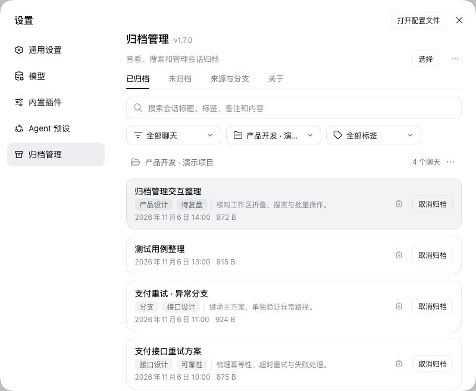
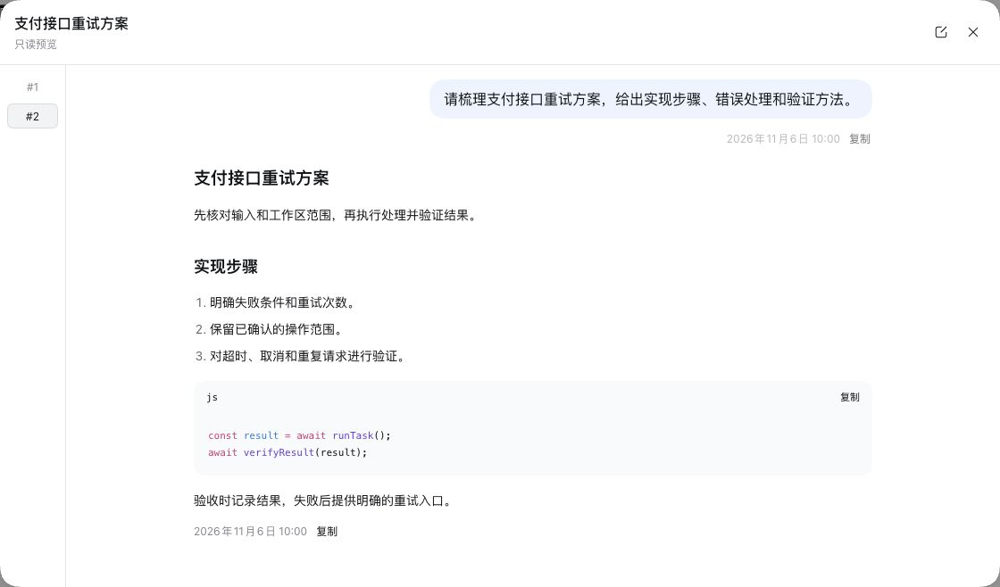
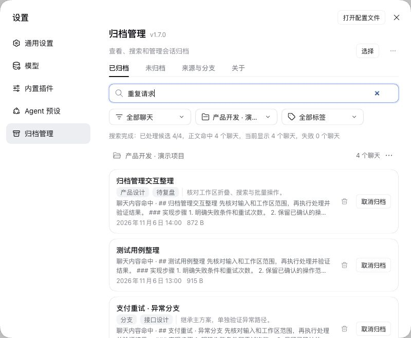
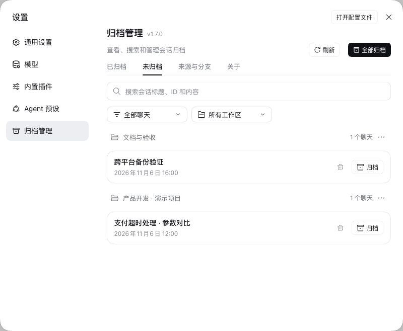
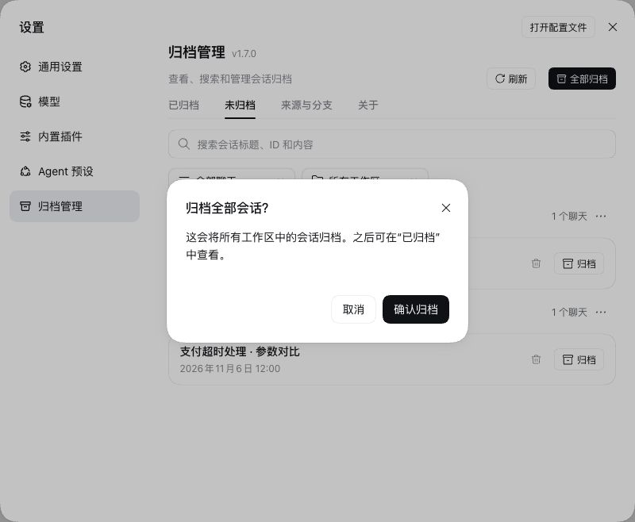
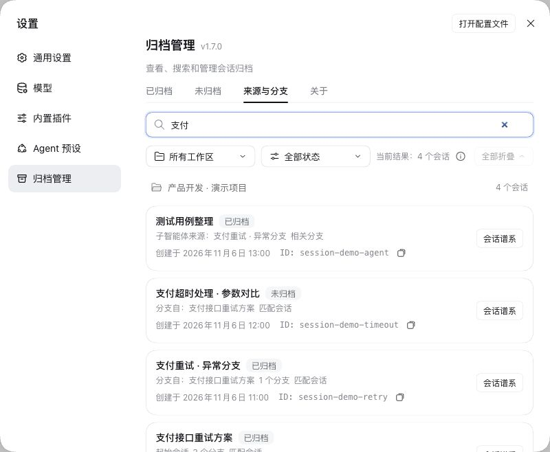
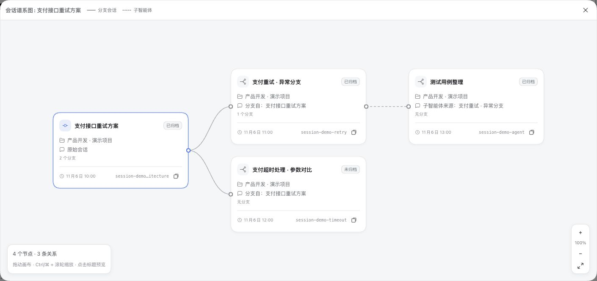
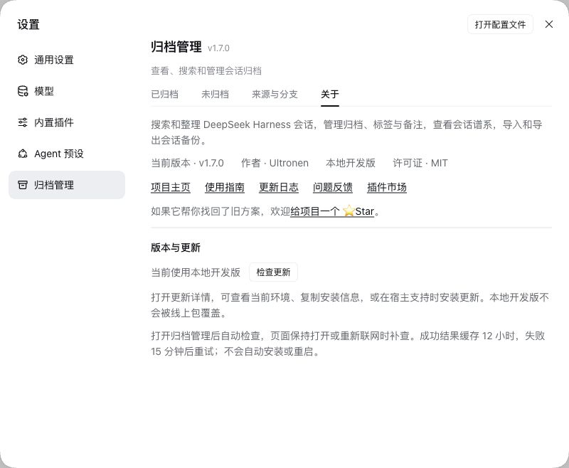

<p align="center">
  
</p>

<div align="center">

<h1>Управление архивами</h1>

<p><strong>Ищите прошлые диалоги DSH, управляйте архивами и сохраняйте резервные копии ZIP.</strong></p>
<p><code>dsh-archived-chats</code></p>

<p><a href="README.md">English</a> · <a href="README.zh-CN.md">简体中文</a> · <a href="README.ja.md">日本語</a> · <a href="README.es.md">Español</a> · <a href="README.fr.md">Français</a> · <a href="README.de.md">Deutsch</a> · <strong>Русский</strong> · <a href="README.pt-BR.md">Português (Brasil)</a></p>

<p><a href="CHANGELOG.md">Changelog</a> · <a href="LICENSE">MIT License</a></p>

<p>
  <a href="https://www.npmjs.com/package/dsh-archived-chats"></a>
  <a href="https://www.npmjs.com/package/dsh-archived-chats"></a>
  <a href="README.md#install-and-open"></a>
  <a href="https://github.com/Ultroncn/dsh-archived-chats/actions/workflows/ci.yml"></a>
  <a href="https://github.com/Ultroncn/dsh-archived-chats/actions/workflows/ci.yml"></a>
</p>
<p>
  <a href="https://github.com/Ultroncn/dsh-archived-chats/blob/main/LICENSE"></a>
  <a href="https://awesome-dsh-plugin.com/p/Ultroncn/dsh-archived-chats/"></a>
  <a href="https://dsh-insights.com/p/Ultroncn/dsh-archived-chats/"></a>
</p>

<p><a href="https://awesome-dsh-plugin.com/p/Ultroncn/dsh-archived-chats/">Plugin market</a> · <a href="https://www.npmjs.com/package/dsh-archived-chats">npm</a> · <a href="https://github.com/Ultroncn/dsh-archived-chats/releases">Releases</a> · <a href="https://github.com/Ultroncn/dsh-archived-chats/discussions">Discussions</a> · <a href="https://github.com/Ultroncn/dsh-archived-chats/security/advisories/new">Private security report</a></p>

</div>

> Этот плагин для DeepSeek Harness поддерживается сообществом и не является официальным продуктом DeepSeek AI.

Archive Management добавляет в DeepSeek Harness поиск по чатам, управление архивом и резервное копирование. С плагином можно найти решение из прошлой переписки, просмотреть сообщения вокруг найденного фрагмента, отправить в архив чаты целого рабочего пространства или сохранить ZIP-копию перед удалением.

- **Поиск по содержимому** — в архивных и неархивированных чатах можно искать по заголовкам, сообщениям и результатам вызова инструментов, а в архивных — ещё и по тегам и заметкам. Результаты показывают совпадения в контексте переписки и дают прямую ссылку на нужное место.
- **Управление чатами** — есть группировка по рабочим пространствам, раздел для чатов без группы, массовые операции, теги и заметки.
- **Резервные копии в ZIP** — экспортируйте и импортируйте архивы с JSON и Markdown. Перед записью можно просмотреть содержимое, а записи с уже существующими идентификаторами пропускаются, чтобы избежать перезаписи.
- **Связи между чатами** — вкладка **Origins & Branches** показывает исходные чаты, ответвления и связи с субагентами в режиме только для чтения. Она охватывает все рабочие пространства, архивные и неархивированные чаты.

> Здесь описана версия 2.0.4. Прежние функции восстановления удалены. Незавершённые задачи окончательного удаления можно повторить вручную.

## Установка и запуск

В каталоге плагинов DSH найдите `dsh-archived-chats`, проверьте имя автора **Ultroncn** и установите плагин. Перезапустите DSH по запросу приложения, затем откройте **Settings → Archive Management** (в китайском интерфейсе **设置 → 归档管理**).

Плагин можно установить и через CLI. Замените `web` именем запущенного профиля DSH. Указывайте тот же профиль при обновлении и удалении плагина.

```sh
dsh plugin --profile web add dsh-archived-chats@latest
```

Если возникает ошибка `ERR_PNPM_ADDING_TO_ROOT`, добавьте флаг `-w` сразу после `add`. Для обновления используйте команду:

```sh
dsh plugin --profile web update dsh-archived-chats
```

## Поиск и резервное копирование чата

1. Откройте **Unarchived** и нажмите на заголовок чата для предварительного просмотра. Затем отправьте нужный чат в архив. Новые пустые чаты исключаются. Для чата, в котором сейчас выполняется работа, подтвердите действие **Stop and archive**.
2. Выполните поиск во вкладке **Archived**. Откройте чат по заголовку или найденному фрагменту. Теги и заметки можно менять прямо в окне предварительного просмотра.
3. Нажмите **Select**, отметьте чаты и выберите **Export selected**. При небольшой ширине окна команда находится в меню с тремя точками. Убедитесь, что ZIP-файл появился в списке загрузок браузера.
4. Чтобы продолжить переписку, выберите **Unarchive**. Удаление необратимо, поэтому заранее решите, нужна ли вам резервная копия.

## Вкладки

| Вкладка | Возможности |
| --- | --- |
| Archived (Архив) | Поиск, фильтры, предварительный просмотр, теги и заметки, импорт и экспорт, извлечение из архива и окончательное удаление с подтверждением |
| Unarchived (Вне архива) | Чаты по рабочим пространствам и без группы, поиск в выбранной области, предварительный просмотр, архивация и окончательное удаление с подтверждением |
| Origins & Branches (Источники и ветки) | Просмотр исходных чатов, ответвлений и субагентов во всех рабочих пространствах и при любых состояниях архивации |
| About (О плагине) | Автоматическая проверка обновлений, обнаружение хоста и локальной копии репозитория, копирование сведений об установке и обновление при поддержке со стороны хоста |

Для поиска по содержимому введите как минимум два символа. Чаты из выбранной области проверяются партиями. Интерфейс показывает ход поиска, найденные фрагменты и ошибки. Поиск можно остановить, а незавершённую обработку — повторить. **Archived** ищет только в архивных чатах, **Unarchived** — только в неархивированных. Обе вкладки открывают предварительный просмотр на месте совпадения. При массовой архивации действуют те же правила исключения скрытых сеансов, что и в списке. Область поиска и ограничения для длинных журналов описаны в [руководстве пользователя](docs/USER_GUIDE.md).

## Архивация и окончательное удаление

Для помещения чатов в архив и извлечения из него используются официальные операции хоста DSH. Окончательное удаление отдельного чата, выбранных чатов, всех чатов рабочего пространства требует подтверждения. Глобальная команда **Delete all** тоже требует подтверждения и охватывает архивные чаты во всех рабочих пространствах. Поиск и фильтры меняют отображение списка. Массовое действие по рабочему пространству или во всех рабочих пространствах охватывает всю соответствующую область.

При окончательном удалении стираются записи и каталоги сеансов, принадлежащие исключительно выбранным чатам и связанным с ними дочерним сеансам субагентов. Каталоги и файлы проектов, общие вложения за пределами каталогов сеансов и отдельные резервные копии сохраняются.

При сбое появляется сообщение об ошибке, а состояние незавершённой операции сохраняется. Кнопка **Retry** возобновляет выполнение в ранее подтверждённой области. Из прежних версий переносятся уже подтверждённые задачи удаления. Прежние операции восстановления и создания защитных снимков удалены. Подробнее см. [окончательное удаление и повторные попытки](docs/USER_GUIDE.md#permanent-deletion-and-retries).

Чат без рабочего каталога остаётся в **Archived**, пока не станет доступен из основного списка чатов DSH.

## Резервные копии и состав ZIP

ZIP-копия чата содержит JSON, Markdown, теги, заметки и ссылки на вложения. Сами файлы вложений в ZIP не входят, поэтому их следует сохранить отдельно. Дочерние чаты субагентов автоматически не включаются. Если они нужны, выберите их для экспорта до удаления. Чтобы восстановить данные, откройте **Import backup** и проверьте содержимое перед импортом. Записи с уже существующими идентификаторами пропускаются.

Перед началом загрузки плагин проверяет, что экспортируемые данные соответствуют формату и ограничениям импорта. Чтобы убедиться, что файл сохранён, проверьте список загрузок браузера.

## Версии и совместимость

При установке старой версии плагина могут снова начать действовать прежние правила очистки. Перед откатом сделайте полную резервную копию данных, проверьте незавершённые задачи и совместимость формата данных.

Заявленный диапазон версий DSH — `>=0.1.0-rc.7 || 0.2.2-rc.1 || 0.2.2-rc.2 || 0.2.2-rc.3`. Доступность отдельных функций зависит от возможностей хоста. Нативные интеграционные тесты охватывают официальные версии серверной части `0.1.7-rc.2`, `0.2.1-rc.2`, `0.2.1-rc.5`, `0.2.2-rc.1` и `0.2.2-rc.3`. CI проверяет эту матрицу на macOS, Windows и Linux.

Архивация, извлечение из архива и получение списка чатов опираются на официальные возможности хоста. При окончательном удалении плагин учитывает жизненный цикл сеансов хоста и расположение их данных. Подробнее см. [совместимость и ограничения](docs/USER_GUIDE.md#compatibility-and-limits).

## Скриншоты

<details>
<summary>Показать скриншоты</summary>

На скриншотах показаны демонстрационные чаты в изолированном экземпляре официального хоста DSH.

1. Архивные чаты по рабочим пространствам

   
2. Предварительный просмотр чата в режиме чтения

   
3. Поиск по содержимому и найденные фрагменты

   
4. Неархивированные чаты

   
5. Подтверждение массовой архивации

   
6. Список источников и веток

   
7. Граф связей между чатами

   
8. Сведения о плагине и обновления

   

</details>

## Удаление плагина

```sh
dsh plugin --profile web remove dsh-archived-chats
```

При удалении пакета сохраняются данные плагина и чаты. Подробнее см. [локальные данные и удаление плагина](docs/USER_GUIDE.md#local-data-and-uninstall).

## Документация и обратная связь

[Руководство пользователя](docs/USER_GUIDE.md) · [Архитектура](docs/ARCHITECTURE.en.md) · [История изменений](CHANGELOG.md) · [Поддержка](SUPPORT.md) · [Руководство для участников проекта](CONTRIBUTING.md) · [Лицензия MIT](LICENSE)

Вопросы и предложения оставляйте в [GitHub Discussions](https://github.com/Ultroncn/dsh-archived-chats/discussions). В сообщениях об ошибках указывайте версии плагина и DSH, минимальные шаги для воспроизведения и текст ошибки без конфиденциальных данных. Об уязвимостях сообщайте [приватно](SECURITY.md).

Команды для разработки приведены в [англоязычном README](README.md#development-and-validation). Нативные проверки используют изолированные временные данные. Для каждой тестовой конфигурации должны выполниться все девять тестов без пропусков.
